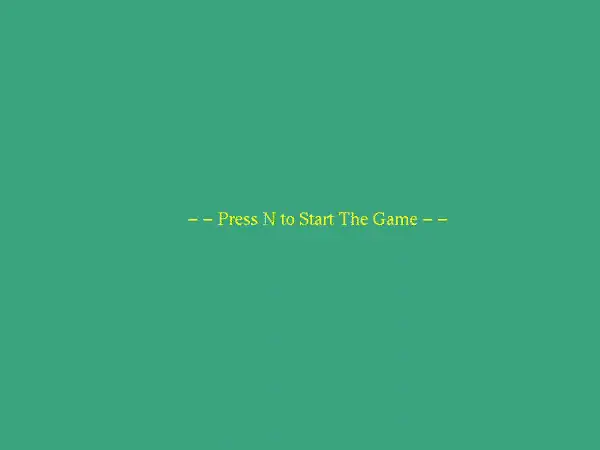

<h1 align="center">User Interactive 3D Chess</h1>

<p align="center">
  Two-player chess on a 3D board, written in C++11 with OpenGL and GLUT.<br/>
  The rules engine has no graphics dependency and is covered by 103 automated checks.
</p>

<p align="center">
  <a href="https://github.com/yxshee/user-interactive-3D-chess/actions/workflows/build.yml"></a>
</p>

<p align="center">
  
</p>

## Quick start

```bash
git clone https://github.com/yxshee/user-interactive-3D-chess.git
cd user-interactive-3D-chess
make run
```

`make` builds a `./chess3d` binary, and `make run` builds it and starts a game. Run it from the repository root: the piece models are loaded from `model/`, and the game exits with a message if it cannot find them.

### Requirements

A C++11 compiler and the OpenGL/GLUT development headers.

| Platform | Install |
|---|---|
| Ubuntu / Debian | `sudo apt install g++ make freeglut3-dev` |
| Fedora | `sudo dnf install gcc-c++ make freeglut-devel` |
| macOS | Xcode Command Line Tools (`xcode-select --install`). OpenGL and GLUT ship with macOS. |

Both platforms are built and tested on every push by [GitHub Actions](.github/workflows/build.yml).

Without `make`, the same build is:

```bash
# Linux
g++ -std=c++11 -O2 -o chess3d main.cpp Model.cpp Chess/*.cpp -lGL -lGLU -lglut
# macOS
clang++ -std=c++11 -O2 -DGL_SILENCE_DEPRECATION -o chess3d main.cpp Model.cpp Chess/*.cpp -framework OpenGL -framework GLUT
```

## Playing

Press `N` to start. Two players share the keyboard and take turns, White first. After each move the board turns to face the player whose turn it is.

| Key | Action |
|:---:|---|
| `W` `A` `S` `D` | Move the cursor (the highlighted square) |
| `Space` | Select a piece, move it to the highlighted square, or cancel the selection |
| Arrow `Left` / `Right` | Rotate the camera around the board |
| Arrow `Up` / `Down` | Zoom out / in |
| `N` | Start a new game (`O` to confirm, `X` to cancel) |
| `Q` `R` `B` `K` | Promote a pawn to Queen, Rook, Bishop or Knight |
| `X` | Close the game after checkmate or stalemate |

When a piece is selected, every square it can legally move to is highlighted: light green for a normal move or en passant, red for a capture, darker green for castling. A move that would leave your own king in check is never offered.

## Rules implemented

| Rule | Status |
|---|---|
| Movement and captures for all six pieces | Yes |
| Check and checkmate | Yes |
| Stalemate (the game ends in a draw) | Yes |
| Castling on both sides: king and rook unmoved, squares between them empty, not out of, through or into check | Yes |
| En passant, only on the move immediately after the double step | Yes |
| Promotion to queen, rook, bishop or knight | Yes |
| Draw by threefold repetition, the fifty-move rule, insufficient material | Not yet |
| Clocks, move list, undo | Not yet |
| Computer opponent | No. This is a two-player game on one keyboard. |

## How it is built

| Path | What it does |
|---|---|
| `Chess/` | The rules engine: board, pieces, move generation and legality (`Gameplay.cpp`), turn and game state (`Game.cpp`). It includes no OpenGL header and builds on its own. |
| `tests/test_rules.cpp` | 103 checks against the engine: start position, pins, en passant, every castling condition, checkmate, stalemate, promotion. |
| `main.cpp` | Window, camera, lighting, keyboard input and drawing of the board and pieces (GLUT). |
| `Model.cpp`, `Model.h` | A small Wavefront `.obj` loader for the piece meshes. Each mesh is compiled into an OpenGL display list the first time it is drawn. |
| `model/` | The six piece models (`King.obj`, `Queen.obj`, ...). |

A move is validated in two stages. `Gameplay::getPossibleMoves` generates every move a piece could make by its movement pattern. `Gameplay::getValidMoves` then plays each candidate on a copy of the board and discards it if the mover's king would be attacked. Castling gets two extra tests there: the king must not be in check now, and the square it crosses must not be attacked. Checkmate and stalemate are both "the side to move has no valid move"; the difference is whether its king is in check.

## Tests

```bash
make test
```

The tests need only a C++ compiler, no OpenGL. They build and run in a few seconds and print a line such as `103 checks, 0 failures`. Coordinates in the test file use rows 1 to 8 from White's side and columns 1 to 8 for files a to h.

## Contributing

Issues and pull requests are welcome. Good first changes are a draw rule (threefold repetition or the fifty-move rule) in `Chess/Gameplay.cpp`, and mouse picking for selecting squares. Please add a test to `tests/test_rules.cpp` with any change to the rules.

## Credits and license

This project builds on [3d-chess-opengl](https://github.com/stevenalbert/3d-chess-opengl) by Steven Albert (2018), released under the MIT License. See [LICENSE](LICENSE). Changes made here on top of it: a macOS build, the test suite and continuous integration, corrected castling rules, stalemate detection, working camera keys, and on-demand rendering.

Maintained by [Yash Dogra](https://github.com/yxshee) (yash999901@gmail.com).
