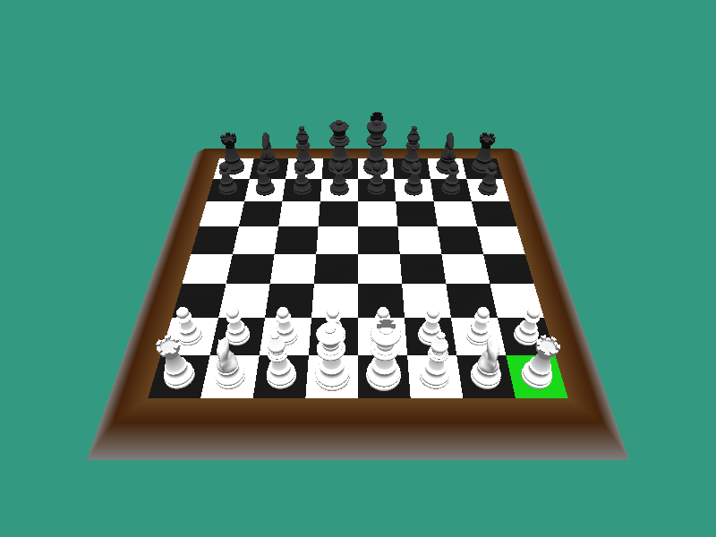

<h1 align="center">User Interactive 3D Chess</h1>

<p align="center">
  Two-player chess on a 3D board, written in C++ with OpenGL and GLUT.
</p>

<p align="center">
  
</p>

## Quick start

```bash
git clone https://github.com/yxshee/user-interactive-3D-chess.git
cd user-interactive-3D-chess
make run
```

`make` builds a `./chess3d` binary, and `make run` builds it and starts a game. Run it from the repository root, because the piece models are loaded from `model/` at startup.

### Requirements

You need a C++11 compiler and the OpenGL/GLUT development headers.

| Platform | Install |
|---|---|
| Ubuntu / Debian | `sudo apt install g++ make freeglut3-dev` |
| Fedora | `sudo dnf install gcc-c++ make freeglut-devel` |
| macOS | Xcode Command Line Tools (`xcode-select --install`). GLUT and OpenGL ship with macOS. |

Without `make`, the same build is:

```bash
# Linux
g++ -std=c++11 -O2 -o chess3d main.cpp Model.cpp Chess/*.cpp -lGL -lGLU -lglut
# macOS
clang++ -std=c++11 -O2 -DGL_SILENCE_DEPRECATION -o chess3d main.cpp Model.cpp Chess/*.cpp -framework OpenGL -framework GLUT
```

## Playing

Press `N` to start. Two players share the keyboard and take turns, White first.

| Key | Action |
|:---:|---|
| `W` `A` `S` `D` | Move the cursor (the highlighted square) |
| `Space` | Select a piece, move it to the highlighted square, or cancel the selection |
| Arrow `Left` / `Right` | Rotate the camera around the board |
| Arrow `Up` / `Down` | Zoom out / in |
| `N` | Start a new game (`O` to confirm, `X` to cancel) |
| `Q` `R` `B` `K` | Promote a pawn to Queen, Rook, Bishop or Knight |
| `X` | Close the game after checkmate or stalemate |

When a piece is selected, the squares it can legally move to are highlighted. The game detects check, checkmate and stalemate. The other draw rules (threefold repetition, the fifty-move rule and insufficient material) are not implemented yet. See [Rules.md](Rules.md) for details.

A longer recording of a game is in [chess-game-demo.gif](chess-game-demo.gif).

## How it is built

| Path | What it does |
|---|---|
| `main.cpp` | Window, camera, lighting, input handling and drawing of the board and pieces (GLUT) |
| `Model.cpp`, `Model.h` | Minimal Wavefront `.obj`/`.mtl` loader for the piece meshes |
| `model/` | The six piece models (`King.obj`, `Queen.obj`, ...) |
| `Chess/` | Game logic with no OpenGL dependency: board, pieces, move generation, check/checkmate (`Gameplay.cpp`), turn and game state (`Game.cpp`) |

## Contributing

Issues and pull requests are welcome. Good first changes are a draw rule (threefold repetition or the fifty-move rule) in `Chess/Gameplay.cpp`, and mouse picking for selecting squares.

## Credits and license

This project builds on [3d-chess-opengl](https://github.com/stevenalbert/3d-chess-opengl) by Steven Albert (2018), released under the MIT License. See [LICENSE](LICENSE).

Maintained by [Yash Dogra](https://github.com/yxshee) (yash999901@gmail.com).
